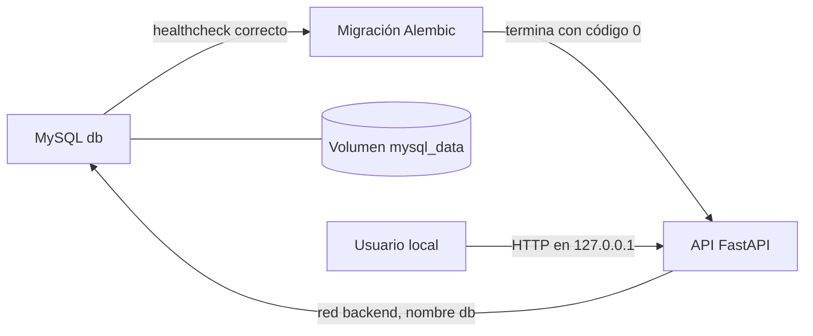

# Orquestación con Docker Compose — Evaluación 2

Fecha: 27 de octubre de 2026. Rama: `feature/e2-compose`, creada desde `develop` en `c6d57d0ad19b3753703f59ef34d85716de370ee8`. Asistencia técnica realizada con Codex; el equipo debe revisar los resultados y elaborar sus propias justificaciones académicas.

## Base verificada y alcance

Antes de desarrollar se revisó el [PR Docker #6](https://github.com/D1E60-C4RR1LL0/despensa-inteligente-api/pull/6): estaba sin conflictos y sus jobs `pruebas` e `imagen` habían pasado. Se integró en `develop`, se actualizó la copia local y se comprobó el éxito del [CI posterior al merge](https://github.com/D1E60-C4RR1LL0/despensa-inteligente-api/actions/runs/40621549512).

Este bloque incorpora la orquestación local de los componentes existentes, configuración por entorno, persistencia y una prueba de integración automatizada. No incorpora herramientas de seguridad, registry, nube ni un despliegue permanente. No se modificaron los endpoints, los modelos ni las migraciones.

## Relación con evaluación y clases

| Elemento | Fuente y clasificación |
|---|---|
| Orquestación con Docker Compose | `[E2-OBLIGATORIO]`: pauta oficial, p. 2, IE5, como alternativa a Kubernetes. |
| Servicios, arranque y logs | `[CLASE]`: semana 6, p. 17–20. |
| Healthcheck y `depends_on` con `service_healthy` | `[CLASE]`: semana 6, p. 23–25. |
| `build` desde Compose y contexto | `[CLASE]`: semana 7, p. 4–5. |
| Variables, archivo de entorno y secretos sin versionar | `[CLASE]`: semana 7, p. 8–11. |
| Volumen nombrado y persistencia | `[CLASE]`: semana 7, p. 12–15. |
| Red y resolución por nombre de servicio | `[CLASE]`: semana 7, p. 16. |
| Política `restart` | `[CLASE]`: semana 7, p. 19–20. |
| Tarea `migrate` y condición `service_completed_successfully` | Adaptación del proyecto para aplicar Alembic una vez antes de arrancar la API. No se atribuye su forma literal a las clases; se contrastó con la documentación oficial de Compose. |
| Helper de secretos y script de auditoría | `[RECOMENDACIÓN]`: automatizaciones propias que facilitan una configuración coherente y obtención de evidencia. Sus nombres, escenarios y valores concretos no son requisitos del docente. |

Los materiales consultados están en Descargas como `semana-6.pdf`, `semana-7.pdf` y `EP2_DOY0101_Estudiante.pdf`. La guía maestra original permanece sin cambios. Los parámetros concretos de imagen, nombres, puerto y tiempos son decisiones verificadas de esta implementación, no valores impuestos por la pauta.

## Arquitectura y secuencia



`docker-compose.yml` define dos servicios permanentes, `db` y `api`, y una tarea breve, `migrate`. La tarea utiliza la misma imagen de la API con el comando `python -m alembic upgrade head`; tiene desactivado el healthcheck HTTP y `restart: "no"`. No es una nueva base de datos ni una herramienta adicional.

MySQL debe responder a `SELECT 1` por TCP usando el usuario y la base configurados. Solo entonces se ejecuta Alembic. La API espera a que MySQL esté saludable y a que la tarea de migración termine correctamente. Si Alembic falla, Compose devuelve un error y la API no inicia.

La API y MySQL comparten la red `backend`; la URL interna utiliza el host `db`. MySQL no publica un puerto en el host. La API publica únicamente en `127.0.0.1`, con puerto 8000 por defecto y `API_PORT` configurable. No se fijan nombres globales de contenedores; Compose identifica sus recursos por proyecto y servicio.

El volumen nombrado `mysql_data` almacena los datos de MySQL. `down` conserva el volumen; `down --volumes` lo elimina. Las políticas `unless-stopped` se aplican a los servicios permanentes. Los healthchecks y dependencias controlan el arranque; esto no equivale a alta disponibilidad, autorrecuperación de todas las dependencias ni autoscaling.

Referencias técnicas primarias: [orden de arranque de Compose](https://docs.docker.com/compose/how-tos/startup-order/), [definición de servicios](https://docs.docker.com/reference/compose-file/services/) e [interpolación de variables](https://docs.docker.com/compose/how-tos/environment-variables/variable-interpolation/).

## Configuración local

```powershell
python scripts/init_compose_env.py
docker compose --env-file .env.compose config --quiet
docker compose --env-file .env.compose up --build --detach --wait --wait-timeout 180
docker compose --env-file .env.compose ps --all
```

La URL predeterminada es `http://localhost:8000/docs`. En `ps --all`, `db` y `api` deben estar saludables; `migrate` debe aparecer finalizado con código 0.

`scripts/init_compose_env.py` crea `.env.compose` si no existe. Genera contraseñas y clave JWT independientes, utiliza credenciales aptas para la URL y construye la conexión interna de forma coherente. La creación exclusiva impide sobrescribir un archivo existente. No muestra secretos en la consola. Los nombres `inventory` de usuario/base pertenecen al stack nuevo; no se presentan como credenciales del MySQL previo.

`.env.compose.example` documenta las variables y deja los secretos vacíos. `.gitignore` excluye `.env` y `.env.*`, permitiendo únicamente los dos archivos de ejemplo. El contexto Docker sigue excluyendo estos archivos. La configuración real se creó localmente y quedó ignorada por Git; el `.env` anterior no se modificó.

`COMPOSE_DATABASE_URL` se convierte en `DATABASE_URL` dentro de los contenedores. El nombre separado evita reutilizar una URL de la consola correspondiente al MySQL local o a la demostración SQLite anterior. La precedencia normal de Compose sigue aplicándose a las variables de la consola; `--env-file` no anula valores ya definidos en el entorno.

`API_IMAGE` selecciona la imagen común de API y migraciones y tiene como valor predeterminado `inventory-api:local`. La auditoría acepta `--image <etiqueta>` para probar una imagen ya construida sin reconstruirla; verifica que ambos contenedores utilicen su identificador exacto y que se conserve tras recrear el stack. Sin esa opción mantiene el build local de la demostración.

Las credenciales y el volumen deben conservarse juntos. Cambiar las variables de inicialización MySQL no cambia las cuentas de un volumen existente. Si se administran credenciales manualmente, hay que mantener coherente la URL interna y revisar el cambio en la base; no eliminar datos para resolver un fallo de autenticación.

Para detener el stack conservando datos:

```powershell
docker compose --env-file .env.compose down
```

## Auditoría reproducible

```powershell
.\venv\Scripts\python.exe scripts/audit_compose.py
```

La auditoría crea un proyecto aleatorio `inventory-audit-*`, una configuración temporal y un puerto local aleatorio. No utiliza `.env.compose`, el `.env` ni el MySQL existente del usuario. Después de probar elimina exclusivamente su proyecto y su volumen. El verificador no necesita paquetes Python adicionales: utiliza la biblioteca estándar y los helpers del repositorio.

| Comprobación ejecutada | Resultado |
|---|---|
| Configuración sin clave JWT | Rechazada antes de levantar servicios. |
| Validación `config --quiet` con configuración completa | Correcta. |
| Arranque desde volumen vacío | Correcto. |
| Healthcheck MySQL y ejecución de migraciones | Correctos. |
| Esquema | Nueve tablas de aplicación, revisión `f3171e47e124`, cero diferencias con los modelos. |
| Healthcheck de la API | `healthy`. |
| OpenAPI, registro, login y creación de categoría por HTTP | Correctos. |
| Productos, stocks, alertas y lista de compras | HTTP 200 con listas vacías. |
| Puerto MySQL publicado en el host | Ninguno. |
| Recreación mediante `down` y `up` | Mismo volumen y usuario/categoría conservados; login correcto. |
| Fallo controlado de migración | Override temporal con salida 7; Compose falla y la API no inicia. |
| Código de salida final de la auditoría | 0. |
| Recursos del proyecto de prueba | Eliminados al terminar. |

La prueba negativa utiliza un archivo override temporal; no cambia las migraciones ni deja roto el Compose del proyecto. Se corrigió la lectura UTF-8 de la salida de Docker en Windows y se repitió la auditoría con resultado correcto.

En la revisión previa al commit se repitió la auditoría con `--image inventory-api:compose-review`: terminó con código 0 y `requested_image_used: true`, mantuvo la persistencia y volvió a comprobar el bloqueo por migración fallida. La imagen efectivamente probada fue `sha256:0aa2146797d949af053cbeb12e14e7b54c1772fb918fc2d61fbd00f0f31b8eae`. Se verificaron además las exclusiones de secretos y la limpieza de los recursos temporales.

La suite completa finalizó con **59 passed, 4 warnings in 29.91s**, código 0. Se conservaron las 57 pruebas anteriores y se añadieron dos casos para evitar sobrescrituras de configuración y verificar coherencia/independencia de las credenciales generadas. Los cuatro avisos de rollback pertenecen a las fixtures anteriores.

```powershell
$env:DATABASE_URL = 'sqlite:///:memory:'
.\venv\Scripts\python.exe -m pytest -q -o log_cli=false
```

## CI y siguiente evidencia

El job `imagen` conserva la construcción Docker y ahora configura Python 3.12 y ejecuta `scripts/audit_compose.py --image inventory-api:${{ github.sha }}`. La revisión previa al commit detectó que la primera versión de la auditoría reconstruía una etiqueta local diferente; se corrigió para probar exactamente la imagen del build, usar `--no-build` y comprobar los identificadores de API y migraciones. Depende de `pruebas`, por lo que una suite fallida impide ejecutar este bloque. Las credenciales se generan de forma efímera en el runner; no requiere secretos de la base del usuario.

La comprobación Compose fue validada localmente con Docker Compose v2.29.2-desktop.2 y después en el [CI del PR #7](https://github.com/D1E60-C4RR1LL0/despensa-inteligente-api/actions/runs/40624495516). Tras integrar el PR en `develop`, el [CI del merge](https://github.com/D1E60-C4RR1LL0/despensa-inteligente-api/actions/runs/40625067399) también terminó correctamente, sobre `a2966e86b84f47575921482fc84649d2982c0d5a`.

Esta auditoría acredita una prueba de integración desechable; todavía no acredita despliegue automático permanente, escaneo de seguridad ni todos los aspectos de escalabilidad de la rúbrica. Esos puntos permanecen en los siguientes bloques. En el bloque posterior de seguridad, `imagen` pasa a depender también de los análisis Snyk: consultar [AUDITORIA_SEGURIDAD.md](AUDITORIA_SEGURIDAD.md).
